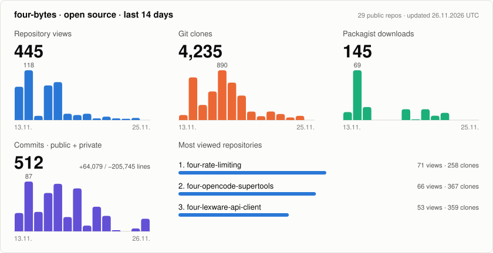

# 👋 Hi, here I am, rock you like a hurricane...

**CEO & Visionary at [Four Flames](https://github.com/four-flames)**
Ibbenbüren, Germany  
“Visions that need to become reality…”

---

## 🚥 About Me

- **Tech Leader**: Byte tamer at [4 Bytes](https://github.com/four-bytes), shaping enterprise software and IT solutions since 2019.
- **Entrepreneur**: Founder and driving force behind [Supreme Chaos Records](https://supremechaos.com), [Cold Knife Records](https://cold-knife.com), and [Four Flames](https://github.com/four-flames) with all its business fields.
- **Dream Builder**: Making dreams come true at [Red Flame](#) and leading diverse ventures — from record labels to logistics, e-commerce, and promotion services.

---

## 🤯 Past & Development fun facts

- Started with 64k cassette storage computers: ATARI 800 XL + Datasette.
- Was always dreaming of a Mega ST Setup with hard drive (!). Bought this later, yet had it only to test a few weeks.
- First PC 286, developing with Turbo Pascal TP.
- Eventually switched to Borland Pascal with Protected Mode Support with 386 platform, combined with TASM.
- Started to build my own OS before Windows including graphics driver stack. Anyone remember smooth scrolling with sprite hacks?
- Was super interested in the demo scene.
- Developed super fast FLI and MOD player.
- Fun but necessary: memory resident DOS CD player (must be around as 7+ archive in the amateur radio boxes).
- Hacking dos games to prevent copy protection popping up - but only for myself of course.
- Developed amateur TV relais control software, deployed it with a group on a huge radio tower with rain coming bottom up.
- Had super interesting projects throughout my time finishing school.
- Developed leading (TÜV) software for non-destructive testing of wire ropes.

---

## 💻 Tech & Skills

- Multi scoped, universal, skills bottom up.
- **Fields**: Dcoument management, web, interfacing, multi channel commerce, logistics, shipping, financing.
- **Languages**: PHP, Python, JS, C#, Visual Basic, frontend languages ... everything is possible..
- **Databases**: MS SQL Server, MySql, MongoDB, Postgres, SqLite, DB/2, ... all data will be processed.
- **Frameworks**: Symfony, Vue.js, .NET, ... build on everything.
- **Modern Platforms**: Shopware, Shopify, Algolia, ... performance matters.
- **Enterprise Platforms**: MS Dynamics/Navision, Salesforce, Sharepoint, ... complexity is not an obstacle.
- **Commerce Platforms**: eBay, Amazon, music dedicated platforms, ... channel it all.
- **Architect**: Multi node, performance, scalability, monitoring, ... modern approach-driven .

---

## 🎸 Music & More

- **Record Labels**: Supreme Chaos Records | Cold Knife Records | Prevision Music
- **Promotion, Distribution, Shops**: Red Flame Promotion, Distribution, Shops
- **Concerts**: Founder & Booker of Metal Nights (Stuttgart, now Northern Germany)
- **Bands**: Karkadan, The Exorial, Cerecloth (all ceased)

---

## 🔗 Connect with Me

- [LinkedIn](https://www.linkedin.com/in/robby-beyer-92885630/)

---

## 💡 Favorite Quotes

> “We need more energy... Nr. 1 - Warp 9 bitte!”  
> “Ich hasse Leute, die sich nicht an ihr Wort halten (und schließe dabei mich selbst nicht aus, im Gegenteil)”  
> “Ich lebe, um Musik zu erleben und sie zu umschlingen wie eine Geliebte, sie nie mehr loszulassen...”  
> “Hast Du den Faden verloren?” ... “Nein, darauf wollte ich gerade zurückkommen...”  
> “Nichtstun macht nur dann Spaß, wenn man eigentlich viel zu tun hätte.” (frei nach Noël Coward)  
> “Wer nicht den Mut hat, sich selbst zu verändern, der hat auch nicht den Mut, die Welt zu verändern.”

---

### ⚡ “Visions need to become reality. Let’s create the future — in code, in music, in brix.”

---

